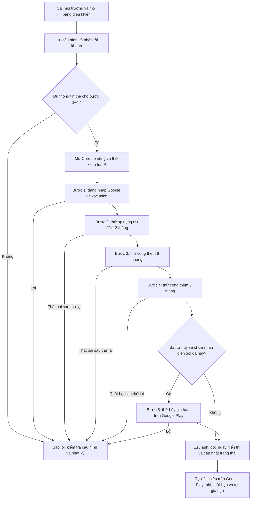

# Bảng điều khiển tự động Google AI Pro (5 TB)

Công cụ tự động hóa quy trình đăng nhập, thử áp dụng các ưu đãi theo thứ tự 12 + 6 + 6 tháng và tùy chọn hủy tự động gia hạn trên Google Play. **24 tháng và US$0.00 là mục tiêu của quy trình, không phải kết quả được bảo đảm.** Điều kiện ưu đãi, thời hạn và khoản thanh toán thực tế do Google quyết định.

## Có cần mua mã không?

**Mã nguồn hiện tại không yêu cầu mua hoặc nhập mã kích hoạt từ một cửa hàng bên ngoài để chạy công cụ.** Không có bước đổi mã mua hàng hay kết nối đến trang bán mã trong ứng dụng. Vì vậy, liên kết bán mã đã được bỏ khỏi hướng dẫn.

- Mã 2FA là mã xác minh của tài khoản Google, không phải mã cần mua.
- Công cụ vẫn cần tài khoản Google và thông tin thẻ khi chạy các bước 1–4. Chỉ chạy bước 5 không yêu cầu điền thẻ qua phần kiểm tra đầu vào này.
- Nếu tự sử dụng proxy trả phí, đó là dịch vụ riêng; ứng dụng không bắt buộc mua mã hay proxy từ một nhà cung cấp cụ thể.

## 1. Yêu cầu môi trường

1. Windows 10 / 11.
2. Đã cài đặt Google Chrome tại đường dẫn mà ứng dụng nhận diện.
3. Python 3.10 trở lên; chọn **Add Python to PATH** khi cài đặt.
4. Kết nối mạng phù hợp với khu vực và điều kiện ưu đãi của tài khoản. Cấu hình gốc dùng khu vực Hoa Kỳ (US); có thể dùng mạng của máy hoặc nhập mẫu proxy trong bảng điều khiển. Tự kiểm tra điều kiện áp dụng chính thức của Google.

## 2. Khởi động nhanh

1. Lần đầu, nhấp đúp vào **1_Lan_dau_cai_dat_va_khoi_dong.bat** để cài các gói Python và khởi động.
2. Những lần sau, nhấp đúp vào **2_Khoi_dong_bang_dieu_khien.bat**.
3. Trình duyệt mở bảng điều khiển tại http://127.0.0.1:8765.

## 3. Cấu hình và nhập tài khoản

### Thẻ thanh toán

Trong phần **Cấu hình chung và liên kết thẻ miễn thuế trực tiếp**, nhập thông tin thẻ của chính bạn có hỗ trợ thanh toán quốc tế:

- Số thẻ Visa hoặc Mastercard.
- Tháng / năm hết hạn, ví dụ `08 / 29`.
- Mã bảo mật CVC.
- Tên chủ thẻ.
- Địa chỉ thanh toán hợp lệ. Mã nguồn mặc định dùng Portland, Oregon, mã bưu chính `97201`; không coi địa chỉ mẫu này là địa chỉ thanh toán của bạn.

Nhấp **💾 Lưu cấu hình**.

**Lưu ý thanh toán:** mã nguồn có kiểm tra các chuỗi `0.00`, `Free` hoặc `免费` trong nội dung hộp thoại trước khi nhấn đăng ký ở các bước 2–4. Đây không phải phép xác minh chắc chắn tổng tiền bằng 0 hay cam kết không bị trừ tiền. Kiểm tra giá, điều khoản dùng thử và tự động gia hạn trực tiếp trên Google trước khi sử dụng.

### Tài khoản Google

Dán tài khoản của bạn vào phần **Nhập hàng loạt tài khoản**, mỗi dòng một tài khoản. Các định dạng được hỗ trợ gồm:

```text
email----mật khẩu----email khôi phục
email----mật khẩu----email khôi phục----khóa bí mật 2FA
email----mật khẩu----khóa bí mật 2FA
```

Nhấp **➕ Nhập danh sách tài khoản**.

**Bảo mật:** ứng dụng lưu cấu hình, thông tin đăng nhập và thông tin thẻ vào `config.json` dạng văn bản không mã hóa. Không chia sẻ hoặc đưa tệp cấu hình đã điền thông tin lên GitHub. Nhật ký và ảnh chụp màn hình cũng có thể chứa thông tin nhạy cảm.

## 4. Luồng hoạt động

Nhấp **▶ Chạy** cho một tài khoản hoặc **▶ Chạy tự động hàng loạt**. Chế độ hàng loạt xử lý từng tài khoản lần lượt.

Lưu đồ dưới đây mô tả luồng đầy đủ bắt đầu từ **bước 1**. Nếu chọn một bước bắt đầu khác, các bước đứng trước nó sẽ được bỏ qua. Trong các bước 2–4, mã nguồn cũng có thể bỏ qua một đợt khi nhận diện mốc thời hạn tương ứng trên trang đăng ký.



### Cách đọc kết quả

- Các bước 2–4 thử áp dụng ưu đãi theo thứ tự 12 + 6 + 6 tháng, đồng thời gửi kèm mục dùng thử YouTube. Kiểm tra cả các mục này và điều kiện gia hạn trên Google. Tài khoản có thể không đủ điều kiện hoặc thao tác có thể thất bại.
- Bước 5 chỉ thử hủy gia hạn khi tùy chọn tự hủy được bật và chưa nhận diện dấu hiệu đăng ký đã hủy. Sau đó ứng dụng lưu ảnh và cố đọc ngày hiển thị trên trang, có thể là ngày hủy hoặc ngày gia hạn.
- Trạng thái **Đã hoàn tất** của ứng dụng không tự chứng minh đã được cấp đủ 24 tháng, không phát sinh phí hoặc đã hủy gia hạn thành công. Mã hiện tại vẫn có thể đánh dấu hoàn tất khi không đọc được ngày hết hạn. Hãy kiểm tra mục Đăng ký và lịch sử thanh toán trong Google Play.
- Không chạy tự động trên tài khoản hoặc phương thức thanh toán của người khác. Chỉ sử dụng khi đáp ứng điều kiện ưu đãi và điều khoản của Google.

### Đối chiếu mã nguồn

- [Nhập tài khoản và chạy hàng đợi](app.py#L188-L384).
- [Kiểm tra nội dung hộp thoại trước khi đăng ký](automation_engine.py#L1205-L1209).
- [Các bước áp dụng ưu đãi](automation_engine.py#L1456-L1567).
- [Tùy chọn hủy, lưu ảnh và cập nhật trạng thái](automation_engine.py#L1568-L1665).
- [Kiểm tra đầu vào và thứ tự chạy](automation_engine.py#L1693-L1786).

## Thông tin tác giả gốc

Các liên kết sau chỉ để tham khảo, không phải điều kiện sử dụng công cụ:

- Blog: https://blog.caowo.de
- Nhóm Telegram: @Hello_Florence
